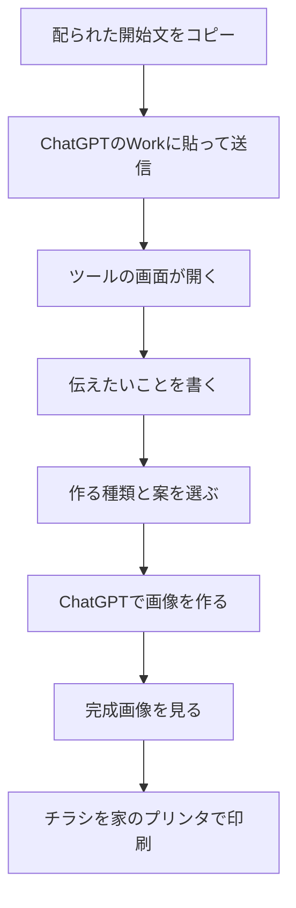
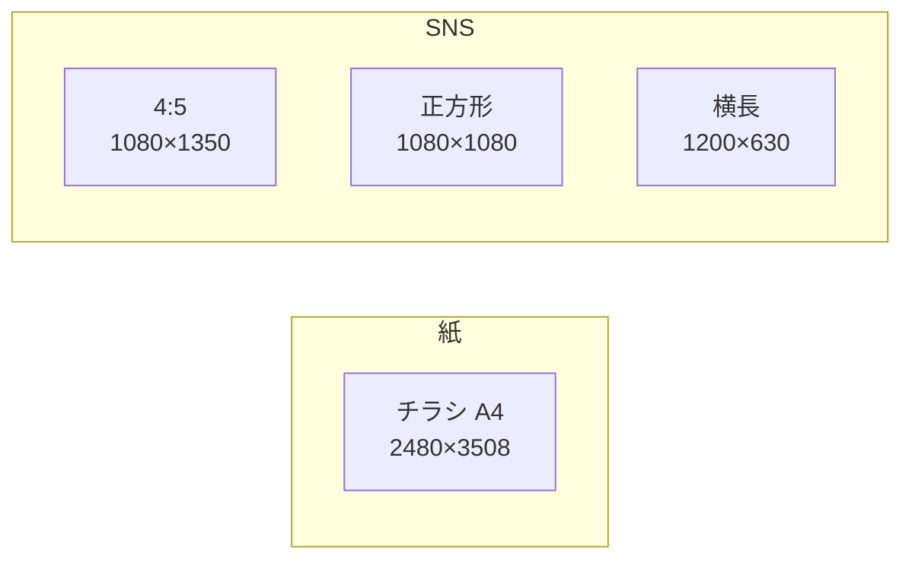

# チラシとSNS画像の作り方

初めての人向けです。むずかしい言葉は、その場で短く説明します。

今日の終わりには、家のプリンタで印刷できるチラシと、SNSに出せる画像を持って帰ります。時間がないときは、チラシ1枚とSNS画像1枚で帰って大丈夫です。

できた画像は、自分の事業にも、頼まれたお客様の仕事にも使えます。

## 始める前に

1. ChatGPTのWorkを開ける状態にします。
2. 事前に配られた「開始文」のファイルを開きます。
3. Zoomのチャットに貼られた文は使いません。チャットの文は途中で切れることがあります。必ず配られたファイルを開いて、全文をコピーします。

開始文のファイルは、この手順と同じ場所にある [開始文.txt](開始文.txt) です。当日はGoogleドライブにも同じ文を置きます。

## 今日の流れ

## 手順

### 1. ツールの画面を作る

開始文を全部コピーして、Workに貼り、送信します。

AIが制作の指示を読み、ツールの画面を作ります。返ってきたリンクを開いてください。リンクはあとでまた開けるように、自分のメモへ残します。

### 2. 質問に答える

画面が開いたら、AIが同じ会話で質問します。事前に原稿を用意する必要はありません。

- サービスやイベントの名前
- ひと目で伝えたいこと
- 見てほしい人にしてほしいこと（呼びかけ）

日時や料金は、決まっているものだけ答えます。決まっていないことは空欄のままにします。答えは「内容を入れる」に入ります。迷ったら「ChatGPTに相談」も使えます。

### 3. 作る種類を選ぶ

「構成を決める」で、今日作るものだけオンにします。

| 種類 | 大きさ | どんなときに使うか |
| --- | --- | --- |
| チラシ A4 | 2480×3508 | 家のプリンタでA4に印刷する |
| SNS 4:5 | 1080×1350 | 縦に長い投稿 |
| SNS 正方形 | 1080×1080 | 正方形の投稿 |
| SNS 横長 | 1200×630 | 横に流れる投稿や、リンクを貼ったときの画像 |

この4つは、同じ絵を引き伸ばしたり、切り取ったりしたものではありません。それぞれ別の絵として作ります。

チラシは、家のプリンタで印刷するPNGです。印刷所に出すPDFは作りません。印刷するときは、紙の端までいっぱいにせず、余白を残します。端の文字が切れにくくなります。

初めてなら、チラシとSNSの4:5だけオンにします。正方形と横長は外してかまいません。

### 4. デザインの案を選ぶ

「デザインを選ぶ」に案が3つあります。案ごとに、雰囲気と色を選べます。

作る案は「この案を作る」がオンのものです。初めてなら1案だけオンにします。

作る枚数は、オンにした案の数 × オンにした種類の数です。

- 案1つ × チラシと4:5 → 2枚
- 案3つ × 4種類全部 → 12枚

画面のボタンに、今の枚数が出ます。多すぎると感じたら、チェックを外して枚数を減らします。

### 5. 画像を作る

「画像を仕上げる」で「ChatGPTで○枚を生成」を押します。

開いた会話に、使いたい写真があれば添付します。写真がなければ、そのままで進めます。

できた画像は「完成画像」に、種類ごとに並びます。

- 直したいときは「修正を依頼」を押します。前の画像は残ります。
- 「一覧から削除」は、この画面の表示から外すだけです。ファイル自体は消えません。

### 6. 持って帰る

- SNS画像は、投稿に使うファイルとして保存します。
- チラシは、家のプリンタでA4に印刷します。余白を残して印刷してください。
- 自分の仕事にも、お客様の仕事にも使ってよいものです。

## うまくいかないとき

配られたファイルを開いて、全文をWorkへ貼ります。チャットの文は使いません。

- 開始文が短く切れている: チャットからコピーし直さず、[開始文.txt](開始文.txt) を開き直します。
- 画面作りや生成が止まった: [やり直す.txt](やり直す.txt)
- 枚数が多すぎる: [2枚だけ作る.txt](2枚だけ作る.txt)。チラシとSNSの4:5、案は1つだけオンにして、ボタンが2枚になることを確認してから生成します。
- 画像を1枚直したい: [修正を依頼する.txt](修正を依頼する.txt)
- 文字が崩れている、誤字がある: [文字を直す.txt](文字を直す.txt)
- 正方形や横長をあとから足す: [別のサイズを足す.txt](別のサイズを足す.txt)
- 完成画像の画面に増えない: 画像ファイルを会話から受け取り、自分のパソコンに保存します。画面へ自動で入らなくても、画像自体は使えます。
