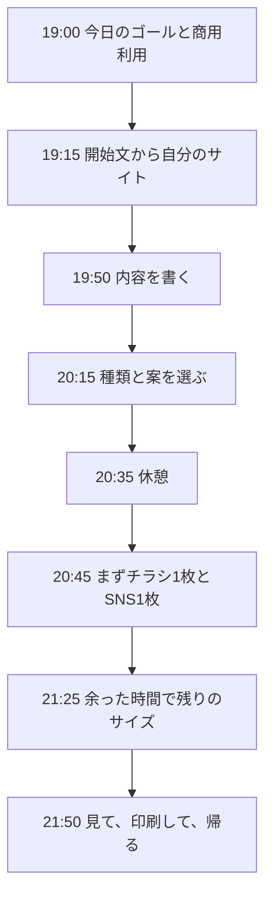

# チラシ・SNS画像の進行

2026年10月24日（土）19:00–22:00。Zoom。題材はSNS告知画像とA4チラシです。

参加者の到達点は、家庭用プリンタで印刷できるチラシPNGを1枚と、SNS画像を1枚持って帰ることです。時間があれば、正方形と横長も作ります。

開始文は [開始文.txt](開始文.txt) をGoogleドライブに置き、そのファイルを開いてコピーしてもらいます。Zoomのチャットへ全文は貼りません。チャットの文は途中で切れて、前回のように制作がずれます。

このファイルの文は、画像版の `STARTER_PROMPT.txt` と同じです。片方だけを直さないでください。

## 当日の流れ

| 時間 | 進めること | その場のゴール |
| --- | --- | --- |
| 19:00–19:15 | 今日持って帰るものと、商用利用を伝える | チラシ1枚とSNS 1枚で帰れると分かっている |
| 19:15–19:50 | ドライブの開始文をWorkへ貼り、自分のサイトを開く | 本人だけのURLが開いている |
| 19:50–20:15 | 名前、ひとこと、呼びかけを入れる | 必須3つが埋まっている |
| 20:15–20:35 | 作る種類と作る案を選ぶ | ボタンの枚数が、選んだ数と一致している |
| 20:35–20:45 | 休憩 | |
| 20:45–21:25 | チラシ1枚とSNS 4:5を1枚生成する | 2枚が会話に戻り、完成画像か手元のファイルで見られる |
| 21:25–21:50 | 余力がある人は正方形・横長、または2案目を足す | 足した人は種類ごとの違いを見比べる |
| 21:50–22:00 | 文字と余白を見て、チラシの印刷方法と商用利用を再確認する | 保存したファイルがある |

## 最初に伝えること

- 開始文はドライブのファイルからコピーする。Zoomのチャットからはコピーしない。
- チラシは家庭用プリンタ向けのPNG。印刷所向けのPDFは今日の到達点に入らない。
- SNSは3種類。4:5（1080×1350）、正方形（1080×1080）、横長（1200×630）。同じ絵の切り抜きではない。
- できた画像は、自分の事業にも、依頼を受けたお客様の仕事にも使ってよい。

## 縮退：チラシ1枚とSNS 1枚で帰る

生成ボタンを押す前に、画面で次だけオンにします。

1. 構成で「このチラシを作る」と「4:5」だけオン。正方形と横長はオフ。
2. デザインは1案だけ「この案を作る」をオン。残り2案はオフ。
3. ボタンが「ChatGPTで2枚を生成」になっていることを、全員で見る。

この2枚が戻った時点で、今日の到達点は満たします。正方形と横長は、21:25以降に足します。足さずに終わっても、未完了にはしません。

サイトの作成で止まった人は、隣の人の画面を見るより、開始文ファイルを開き直して、全文が入っているかだけ確認します。切れていたら、チャットの文ではなくファイルから貼り直します。

## 終わりに見るところ

- チラシの文字とURLが、紙の端に寄りすぎていないか。
- SNSの3種類を作った人は、同じ構図のサイズ違いになっていないか。
- 完成画像の画面に自動で並ばなくても、会話から受け取ったPNGを保存できていれば持ち帰りにする。
- 商用利用してよいことを、もう一度伝える。
