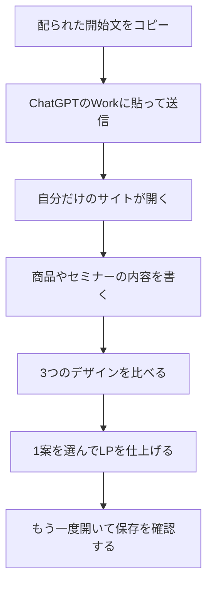

# LPの作り方

初めての人向けです。

今日の終わりには、自分だけが開けるLP制作ツールと、仕上げたLPを1つ持って帰ります。時間があれば、2案目、3案目も仕上げます。

できたLPは、自分の事業にも、頼まれたお客様の仕事にも使えます。

## 始める前に

1. ChatGPTのWorkを開ける状態にします。
2. 配られた「開始文」のファイルを開きます。この手順と同じ場所の [開始文.txt](開始文.txt) です。
3. Zoomのチャットに貼られた文は使いません。必ずファイルを開いて、全文をコピーします。

## 今日の流れ

## 手順

### 1. 自分だけの制作サイトを作る

開始文の2行をまとめてコピーし、Workに貼って送信します。

AIが制作指示を読み、あなただけが開けるサイトを作ります。返ってきたリンクを開きます。リンクは、あとで開けるように自分のメモへ残します。

### 2. 伝えたいことを書く

サイトで、次を入れます。

- 商品やセミナーの名前
- 誰に向けたものか
- 何を提供し、何を持ち帰れるか
- 決まっている日時、場所、料金、申込先

決まっていないことは空欄のままにします。迷ったら「ChatGPTに相談」を使います。相談は、見えている事業情報から入力案を作るもので、サイトがすべてのチャットを直接読む機能ではありません。

「サンプルを試す」は、入力の見本です。見本の文章を、自分の情報として残しません。

### 3. 3案を比べる

9つの方向から、3つのデザインを選びます。この画面の比較は、仕上がり前のHTMLです。写真を指定していない欄は「画像」の仮枠です。

### 4. LPを仕上げる

Workで仕上げる案を選びます。初めてなら1案です。

ツールが用意した依頼文をWorkへ送ります。使う写真は、その会話に別で添付します。写真は依頼文の中には入りません。

### 5. 持って帰る

完成したLPを開き、制作一覧からもう一度開けることを確認します。URLを保存します。

一般公開やSNSへの投稿は、別の操作です。

## うまくいかないとき

- 開始文が短く切れている: チャットからコピーし直さず、配られたファイルを開き直します。
- サイトが新しく作れない: 前のサイトへ移さず、返ってきた理由を見ます。
- 写真が出ない: 依頼の会話に、写真を添付し直します。
