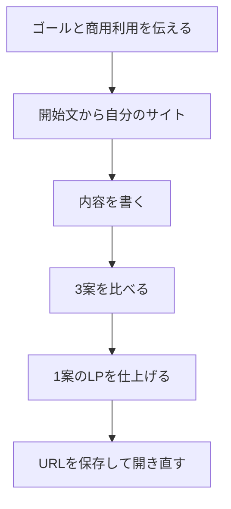

# LPの進行

参加者の到達点は、自分だけのLP制作ツールが開き、LPを1つ仕上げて、そのURLをもう一度開けることです。時間があれば2案目、3案目を足します。

開始文は [開始文.txt](開始文.txt) をファイルで渡します。Zoomのチャットへ全文は貼りません。

## 順番

| 順番 | 進めること | その場のゴール |
| --- | --- | --- |
| 1 | 今日持って帰るものと、商用利用を伝える | LPを1つ仕上げれば帰れると分かっている |
| 2 | 開始文をWorkへ貼り、自分のサイトを開く | 本人だけのURLが開いている |
| 3 | 名前、相手、提供内容、決まっている申込情報を入れる | 空欄と、決まった情報が分かれている |
| 4 | 3案を比べ、仕上げる1案を選ぶ | 選んだ案だけが依頼に入る |
| 5 | 依頼文を送り、写真があれば添付する | LPのURLが返っている |
| 6 | 制作一覧から開き直す | 保存したURLがある |

## 最初に伝えること

- 開始文は配られたファイルからコピーする。Zoomのチャットからはコピーしない。
- できたLPは、自分の事業にも、依頼を受けたお客様の仕事にも使ってよい。
- マイサイトの登録は、この作業の前提にしない。

## 時間が足りないとき

仕上げは1案で止めます。3案の比較画面まで進んでいれば、LPのURLは次の機会に続けられます。サイトの作成で止まった人は、開始文ファイルを開き直し、2行がそろっているかだけ確認します。

## 終わりに見るところ

- 決まっていない日時、料金、実績が、文章の中に増えていないか。
- 写真を使うLPは、会話に添付した写真になっているか。
- URLを自分のメモに残しているか。
- 商用利用してよいことを、もう一度伝える。
