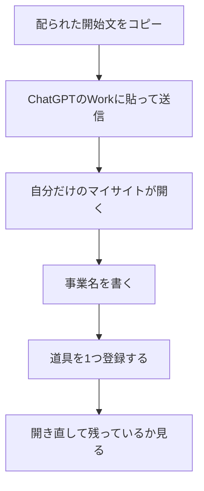

# マイサイトの作り方

初めての人向けです。

終わりには、自分だけが開ける仕事場があり、道具を1つ登録できていれば十分です。

## 始める前に

1. ChatGPTのWorkを開ける状態にします。
2. 配られた「開始文」のファイルを開きます。この手順と同じ場所の [開始文.txt](開始文.txt) です。
3. Zoomのチャットに貼られた文は使いません。必ずファイルを開いて、全文をコピーします。

## 流れ

## 手順

### 1. 自分だけのサイトを作る

開始文を全部コピーして、Workに貼り、送信します。

返ってきたリンクを開きます。リンクは自分のメモへ残します。

新しいサイトの一覧は空です。前のサイトの登録は、自動では入りません。

### 2. 仕事場だと分かる名前を書く

事業プロフィールに、自分の事業名を入れます。決まっていない項目は空欄のままにします。

### 3. 道具を1つ登録する

「＋ 追加」から種類を選びます。

- Web: 開くURL
- ファイル: 手元の場所。サイトからそのファイルは実行しません
- スキル: 参照するURLや場所。サイトへインストールしません
- プロンプト: 本文をコピーして使う
- その他: 参照先のメモ

名前と参照先を入れて保存します。

「一覧から外す」は、このマイサイトの登録だけを外します。元のファイルやサイトは消えません。

### 4. 持って帰る

ページを開き直し、登録が残っていることを確認します。URLを保存します。

秘密のパスワードや鍵は、このサイトへ書きません。

## うまくいかないとき

- 開始文が短く切れている: 配られたファイルを開き直します。
- 一覧に見本が入っている: 新規のサイトは空が正しい状態です。見本を自分の登録として残しません。
