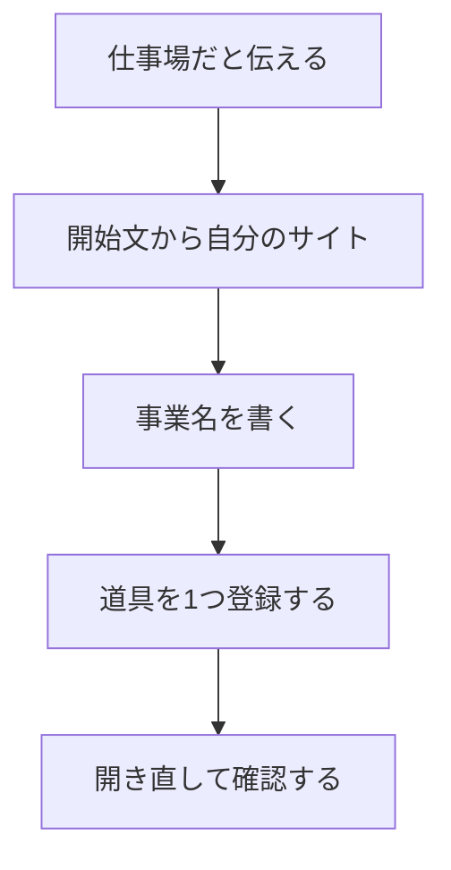

# マイサイトの進行

参加者の到達点は、自分だけのマイサイトが開き、道具を1つ登録して、開き直しても残っていることです。

開始文は [開始文.txt](開始文.txt) をファイルで渡します。Zoomのチャットへ全文は貼りません。

LPやチラシ・SNS画像の作業では、マイサイトの登録を前提にしません。

## 順番

| 順番 | 進めること | その場のゴール |
| --- | --- | --- |
| 1 | マイサイトは道具の置き場だと伝える | 何を1つ登録するか決まっている |
| 2 | 開始文をWorkへ貼り、サイトを開く | 本人だけのURLが開き、一覧は空 |
| 3 | 事業名を入れる | プロフィールに名前がある |
| 4 | Web、ファイル、スキル、プロンプトのどれか1つを登録する | カードが1枚ある |
| 5 | 開き直す | 登録が残っている |

## 時間が足りないとき

登録は1件で止めます。サイトのURLが開いていれば、登録はあとから足せます。サイトの作成で止まった人は、開始文ファイルの全文が入っているかだけ確認します。

## 終わりに見るところ

- 新規なのに、ほかの人の道具が入っていないか。
- パスワードや秘密の鍵を書いていないか。
- URLを自分のメモに残しているか。
