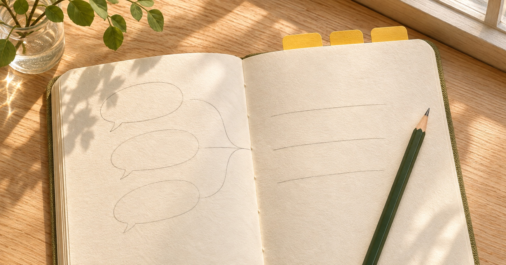

# お客さんからよく聞かれる質問を、noteの記事にする

寺子屋AI第3回のサンプル記事。見出し画像はこの記事に合わせて生成しました。

何を書こうか迷ったら、最近お客さんに聞かれたことを一つ思い出してみてください。会話ではすぐ答えられる質問でも、初めての人にとっては、相談するかどうかを決める材料になります。

## 質問を一つ選ぶ

たとえば「相談の前に、何を用意したらいいですか？」です。誰か一人の事情に踏み込みすぎず、初めての人にも役立つ問いを選びます。相談者の名前や具体的な案件の情報は、題材のメモから外しておきます。

## 最初の段落に答えを書く

「今困っていることを、一行だけメモしておけば大丈夫です」と先に答えます。次の段落で、メモには「今どうなっているか」「どこで手が止まったか」を書くと相談が始めやすい、と理由を添えます。手元に資料があれば、何の資料か説明できるようにしておくと話が進みます。

## 読み返して、次の一歩を添える

本文が書けたら、初めて読む人のつもりで見出しを追います。「資料の準備」という見出しだけでは何をするか分かりにくいので、「困っていることを一行メモする」のように動作が分かる言葉にします。最後は「最近よく聞かれた質問を、まず一つ書き出してみてください」と結べば、読んだ人も試せます。
